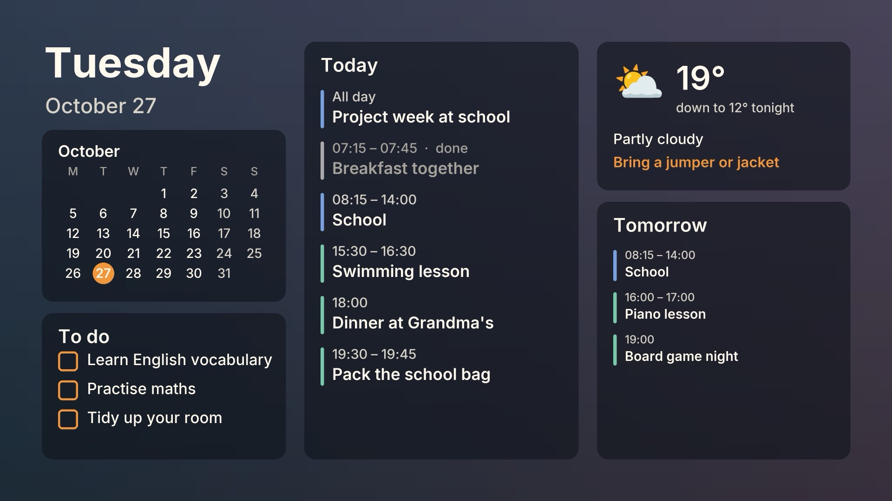
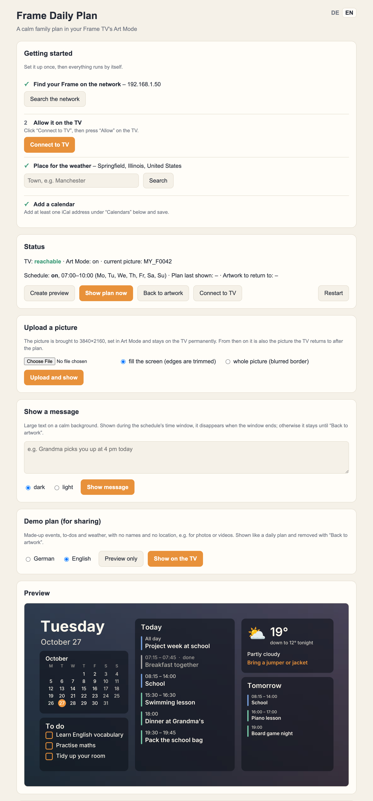

# Frame Daily Plan

**Project page:** https://justifytechexpenses.github.io/frame-daily-plan/

A calm morning planner for the **Samsung The Frame** TV. Each morning (by default 7:00 to 10:00) your Frame shows the family's day in Art Mode instead of a painting:

- today's and tomorrow's events,
- to-dos,
- the weather with a "what to wear" hint, the next 3 days and a rain radar map,
- a month calendar.

Afterwards it switches back to the artwork you had, and it deletes the plan image so nothing piles up.



It runs as a small Docker container on an always-on machine at home, such as a Synology NAS or a Raspberry Pi. You set everything up in a web page:



## Why

Art Mode is quiet, ad-free and always on the wall, so it's a good place for a family plan. Children who do best with a predictable day can see what is coming without a phone or a TV menu full of ads. The plan never interrupts a TV programme: if someone is watching, it waits until Art Mode comes back on.

## Features

- **Calendars**: any iCal feed, such as Google Calendar's secret address, Apple iCloud's public calendars or school calendars. Each calendar gets one of ten colours. A calendar can also be a "to-do" calendar, where every entry goes on the to-do list.
- **Public holidays** for about 150 countries and their regions.
- **Weather** from [Open-Meteo](https://open-meteo.com/) (no API key) or [Pirate Weather](https://pirateweather.net/) (free API key), in °C or °F.
- **3-day outlook** and a **rain radar map** around home ([RainViewer](https://www.rainviewer.com/) over [OpenStreetMap](https://www.openstreetmap.org/copyright)).
- **Current conditions** (optional): the temperature "now", and "Raining now" while it rains, from Open-Meteo or your own weather station (Home Assistant, MQTT, Ambient Weather or Weather Underground).
- **24-hour or 12-hour times** (picking a place in the US switches to °F and 12-hour times).
- **Several schedules**, e.g. mornings every day and evenings on weekdays. Each time window shows a fresh plan.
- **Plan and web page in German, British English or American English** (US: "sweater", weeks starting on Sunday).
- **Plan on your artwork**: the plan sits on a blurred copy of the picture it replaces. You can also use a calm built-in gradient.
- **Upload your own picture**: it is fitted to 3840×2160 and kept on the TV as your normal artwork.
- **Show a message**: big text on a calm background, e.g. "Grandma picks you up at 4 pm today".

  

- **Demo plan** with made-up data, for photos and videos.
- Past events turn grey. Long titles shrink to fit and are never cut off.

## Requirements

- **A Samsung The Frame** on your home network. 2017/2018 Frames and newer ones upload differently; the app picks the right way from the TV's art API version. Please report your model (see Compatibility below).
- **An always-on machine that runs Docker**, on the same network as the TV: for example a Synology NAS with Container Manager, a Raspberry Pi, or any Linux server. Images are built for `amd64` and `arm64`.
- **Calendar links in iCal format.** Google Calendar: *Settings → your calendar → "Secret address in iCal format"*.
- No Samsung account, no SmartThings, no cloud service. Internet access is only needed for the calendars and the weather.

## Install

### Synology (Container Manager)

1. In **File Station**, create a folder `docker/frame-daily-plan`.
2. **Container Manager → Project → Create**. Name it `frame-daily-plan`, set the path to that folder and choose **"Create docker-compose.yml"**. Paste:

   ```yaml
   services:
     frame-daily-plan:
       image: ghcr.io/justifytechexpenses/frame-daily-plan:latest
       container_name: frame-daily-plan
       restart: unless-stopped
       network_mode: host
       environment:
         TZ: Europe/London
       volumes:
         - ./data:/data
   ```

3. Finish the wizard. The container starts.
4. Open `http://<your-NAS>:8765` and follow **Getting started**.

### Any Docker host (Raspberry Pi, Linux server)

```bash
mkdir frame-daily-plan && cd frame-daily-plan
curl -O https://raw.githubusercontent.com/JustifyTechExpenses/frame-daily-plan/main/docker-compose.yml
docker compose up -d
```

Then open `http://<host>:8765`.

### Getting started (in the web page)

1. **Search the network.** The app finds your Frame (or enter its IP address by hand).
2. **Connect to TV.** Click it, then press **Allow** on the TV within two minutes.
3. **Place for the weather.** Type your town and pick it. This also sets the time zone and the holiday country.
4. **Calendars.** Paste your iCal addresses, pick colours, and save.

Use **Create preview** to see the plan without touching the TV, and **Show plan now** to try it on the TV.

## How it behaves

- At the start of each schedule's time window, the app remembers the current artwork, uploads a fresh plan and shows it. If the TV is in TV mode, the plan just waits.
- At its end, it switches back to that artwork and deletes the plan.
- Anything you show by hand *inside* that window disappears at its end. Anything you show *outside* it stays until **Back to artwork**.
- If the TV is asleep or unreachable, the app retries every 2 minutes during the time window, so the plan appears soon after the TV wakes up.
- Only images the app uploaded itself are ever deleted. Your photos and Samsung art are never touched.

## Security

The web page shows your private calendar links and weather-station keys (all stored in `data/config.json`). Keep it inside your home network, and don't forward the port to the internet. To add a password, set `FRAME_PLAN_PASSWORD` in `docker-compose.yml`.

## Troubleshooting

- **"TV not reachable" or "Connect" times out.** Press **Allow** on the TV while the app is waiting. If you once pressed *Deny*, open *Settings → General → External Device Manager → Device Connection Manager → Device List* on the TV, and allow or delete "Frame Daily Plan".
- **"Search the network" finds nothing.** The container needs `network_mode: host`. Or enter the TV's IP address by hand.
- **New calendar entries don't show up.** Google updates secret iCal feeds with a delay, sometimes up to a few hours.
- **"Show plan now" fails.** The log shows how far it got ("Connected … (art API x)", "uploading …"). To test the TV on its own, run the TV library's own check: `docker exec -it frame-daily-plan python -m samsungframetv.diagnose <TV-IP> -t /data/tv-token.txt` (add `--upload some.jpg` to try an upload, which is deleted again).
- **No "now" temperature.** Use **Test** under "Current conditions". For MQTT, values older than 15 minutes are ignored.
- **The log** is at the bottom of the web page and in `data/frame-daily-plan.log`.

## Compatibility

| Model | Year | Art API | Status |
| --- | --- | --- | --- |
| UE55LS003 | 2017 | 1.07 | ✅ works |
| QN65LS03D | 2024 | 5.0.1.0 | ✅ works |

Tried another Frame? Please open an issue with the model, year and whether it worked.

## Development

```bash
python3 -m venv .venv && .venv/bin/pip install -r requirements.txt pytest
.venv/bin/python -m pytest tests
FRAME_PLAN_DATA=./data .venv/bin/python app/web.py   # http://localhost:8765
```

## Credits and licence

MIT, see `LICENSE`. Third-party parts and their licences are listed in `THIRD_PARTY_NOTICES.md`; the Samsung connection uses [samsungframetv](https://github.com/NickWaterton/samsung-tv-ws-api) (LGPL-3.0). Weather data is by [Open-Meteo.com](https://open-meteo.com/) (CC BY 4.0).

Not affiliated with or endorsed by Samsung. "Samsung", "The Frame" and "SmartThings" are trademarks of Samsung Electronics.
